# 📱 Mashiro Android — План реализации мобильного клиента

> Неофициальный клиент «Яндекс Музыки» для Android на базе **Tauri 2.0 Mobile**, **Rust** и **Vue 3**, создаваемый на основе десктопного клиента [Mashiro v2](https://github.com/aeviww/yandex-music-client/tree/v2).

---

## 🌟 Краткое содержание проекта

Данный проект переносит всю мощь, скорость и эстетику десктопного клиента **Mashiro** на платформу **Android**, сохраняя 100% Rust-логики и свыше 85% Vue-компонентов, а также решая ключевые мобильные вызовы:

1. **⚡ Перенос Rust-логики**: Полная компиляция библиотеки `mashiro_lib` под Android NDK (`arm64-v8a`) с поддержкой API Я.Музыки, криптографии, подписи потоков, кэширования и P2P-релеев Together.
2. **✨ Перенос Vue-красоты и мобильная эргономика**: 
   - Полное устранение десктопного бокового сайдбара на смартфонах — 100% ширины отдано под контент.
   - Фиксация естественной **вертикальной (портретной) ориентации** без необходимости поворачивать телефон.
   - **Правило большого пальца (Thumb Zone)**: нижняя панель навигации `BottomNav`, плавающий мини-плеер со свайпами и нижние шторки `BottomSheet`.
   - Сохранение фирменной эстетики: 11 тем оформления (включая чистый OLED Black), 8 акцентных цветов, динамические размытые градиенты обложек (Ambient Glow), LRC-караоке.
3. **📁 Замена своих треков и синхронизация с ПК**: 
   - Возможность подменить любой трек на собственный аудиофайл (локально или по ссылке).
   - Встроенный **Wi-Fi Sync Server** на Rust: достаточно открыть адрес `http://<ip-телефона>:8765` в браузере на компьютере и перетащить треки прямо на экран!
   - Поддержка папки `/storage/emulated/0/Music/Mashiro/` с маской `Исполнитель - Трек [id].ext`.
   - Поддержка системного файлового пикера Android (SAF).
4. **🛡️ Анти ИИ-слоп (Slopless API)**:
   - Автоматическая проверка артистов и треков через базу `https://slopless.art`.
   - Визуальные неоновые бейджи `AI` в списке и плеере.
   - Опция **автоматического пропуска ИИ-треков в «Моей волне»** без участия пользователя.
5. **🚫 Автозамена цензурных треков (FckCensorData)**:
   - Интеграция с базой `Hazzz895/FckCensorData` (`list.json`).
   - Автоматическая подмена цензурированных версий на оригинальные треки без цензуры (Explicit).
   - Бесшовный механизм Fallback: если внешний источник недоступен, трек не зависает, а переключается на стандартную версию.
   - Переключатель версии «на лету» прямо на экране плеера.
6. **🎧 Настоящее фоновое воспроизведение (Jetpack Media3)**:
   - Работа через нативный Android **`MediaSessionService`** и **ExoPlayer**.
   - Полноценная шторка уведомлений `MediaStyle` с перемоткой, обложкой высокого разрешения, кнопками гарнитуры, управлением с экрана блокировки и умных часов.
   - Корректная обработка звонков (Audio Focus) и отсутствие остановок в Doze Mode.

---

## 🏗️ Архитектура системы

```mermaid
graph TD
    subgraph UI ["Фронтенд (Vue 3 / Quasar / Tailwind)"]
        Nav["Нижняя навигация BottomNav + Экраны: Главная, Волна, Коллекция"]
        PlayerUI["Мини-плеер + Полноэкранный плеер + LRC караоке + BottomSheets"]
        SettingsUI["Настройки: Темы, Wi-Fi синхронизация, ИИ, Цензура"]
    end

    subgraph IPC ["Tauri 2 Mobile IPC Bridge"]
        Bridge["JNI / WebMessageListener (двусторонний канал)"]
    end

    subgraph RustCore ["Нативное ядро Rust (mashiro_lib.so)"]
        YandexAPI["API Яндекс Музыки (Каталог, Волна, Стримы)"]
        Slopless["Slopless Engine (Анти-ИИ фильтрация)"]
        FckCensor["FckCensor Engine (Обход цензуры)"]
        WiFiServer["Wi-Fi Sync Server (Загрузка с ПК)"]
        Together["Together P2P (Совместное прослушивание)"]
    end

    subgraph AndroidNative ["Android Native OS (Kotlin)"]
        Service["MashiroMediaService (Foreground Service)"]
        ExoPlayer["Jetpack Media3 ExoPlayer Engine"]
        Notification["MediaStyle Notification + Lockscreen"]
        Storage["Music/Mashiro + SAF File Access"]
    end

    UI <--> IPC
    IPC <--> RustCore
    IPC <--> AndroidNative
    RustCore -->|Стрим/Кэш/Файлы| AndroidNative
    WiFiServer <-->|Wi-Fi HTTP Drag-n-Drop| PC["Компьютер пользователя"]
```



---

## 📚 Подробная проектная документация (Папка `plan/`)

Полное техническое описание каждого модуля разбито по отдельным файлам в папке `plan/`:

| № | Файл | Краткое описание содержания |
|---|---|---|
| **01** | [**Архитектура и технологический стек**](plan/01_architecture_and_stack.md) | Обоснование выбора Tauri 2 Mobile, схема слоев, разделение обязанностей (Rust / Kotlin / Vue), файловая структура. |
| **02** | [**Перенос и компиляция Rust-ядра**](plan/02_rust_core_migration.md) | Компиляция под Android NDK (`arm64-v8a`), аудит зависимостей `Cargo.toml`, обход ограничений симлинков и кириллических путей. |
| **03** | [**Нативный аудиодвижок Android**](plan/03_android_audio_engine.md) | Решение проблемы сна WebView, Jetpack Media3 ExoPlayer, Foreground Service, системная шторка с seekbar, Audio Focus, эквалайзер. |
| **04** | [**Замена треков и синхронизация с ПК**](plan/04_local_tracks_and_pc_sync.md) | Архитектура подмены треков, Scoped Storage, папка `Music/Mashiro`, встроенный Wi-Fi Sync веб-сервер для загрузки с ПК по воздуху, экспорт/импорт. |
| **05** | [**Модуль «Анти ИИ-слоп» (Slopless)**](plan/05_anti_ai_slop.md) | Интеграция с API `slopless.art`, пороги детекции, пакетное кэширование, индикатор `AiTag`, автопропуск ИИ-треков в «Моей волне». |
| **06** | [**Автозамена цензурных треков**](plan/06_censor_bypass.md) | Интеграция с `Hazzz895/FckCensorData`, кэширование `list.json`, отказоустойчивый Fallback при сбое CDN, переключатель версий на лету. |
| **07** | [**Мобильный редизайн интерфейса (Vue Beauty)**](plan/07_vue_ui_mobile_redesign.md) | Адаптация Quasar и Tailwind: нижняя навигация, док-миниплеер, полноэкранный плеер с караоке LRC, bottom sheet меню, safe area insets, AMOLED темы, haptics. |
| **08** | [**Подготовка среды разработки и сборка**](plan/08_dev_environment_and_build.md) | Инструкция по настройке Windows, Android Studio, SDK, NDK, Rustup, запуск с Live Reload, сборка APK/AAB. |
| **09** | [**Поэтапный план реализации (Roadmap)**](plan/09_implementation_roadmap.md) | График из 6 фаз разработки, текущий статус реализации, чек-листы и матрица рисков. |
| **10** | [**Мобильная эргономика и сенсорный UX**](plan/10_mobile_ergonomics_and_touch_ux.md) | Правило большого пальца (Thumb Zone), ликвидация бокового сайдбара, портретная ориентация, жесты смахивания и шторки. |

---

## 🚀 Быстрый запуск и сборка APK

Сборка приложения нативно автоматизирована одной командой:

```powershell
# Сборка готового APK (frontend + Rust + Media3) за ~10 секунд:
npm run android:build
```

Готовый файл APK генерируется в:
[`src-tauri/gen/android/app/build/outputs/apk/arm64/debug/app-arm64-debug.apk`](file:///f:/project/mashiro-android/src-tauri/gen/android/app/build/outputs/apk/arm64/debug/app-arm64-debug.apk)
