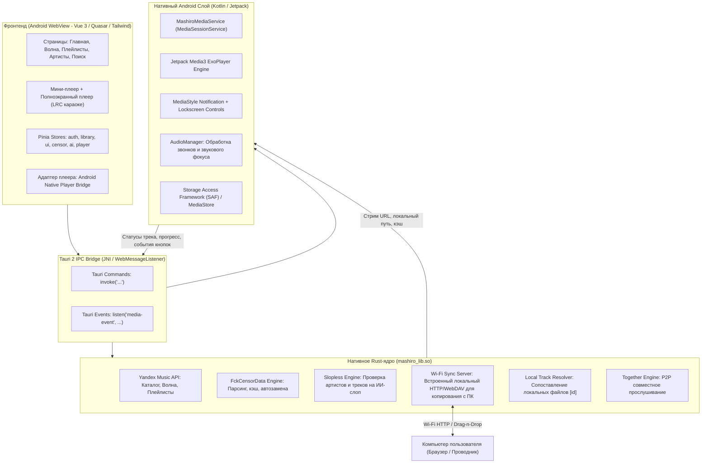

# 01. Архитектура и технологический стек Mashiro Android

Данный документ описывает общую архитектурную модель мобильного клиента **Mashiro** для Android, детальное обоснование выбора стека и схему взаимодействия компонентов.

---

## 1. Анализ исходного проекта (v2) и вызовы переноса на Android

Оригинальный проект `aeviww/yandex-music-client` (ветка `v2`) представляет собой гибридное настольное приложение:
- **Бэкенд / Ядро**: Rust (`desktop/src-tauri`), использующий Tauri 2.0 (`tauri = "2"`, `reqwest` с `rustls-tls`, `tokio`, криптография подписи аудиопотоков, API «Яндекс Музыки», Slopless AI, FckCensorData, Genius/LRCLIB, P2P/Relay Together).
- **Фронтенд / Интерфейс**: Vue 3 + TypeScript + Quasar Framework + Tailwind CSS + Pinia.
- **Воспроизведение звука на ПК**: Web Audio API (`new Audio()` + `AudioContext` с Biquad-фильтрами для эквалайзера и нормализатора громкости).

### Ключевые проблемы прямого переноса на Android:
1. **Фоновое воспроизведение и жизненный цикл**: В Android WebView при блокировке экрана или сворачивании приложения браузерный движок Chrome/WebView замораживает JavaScript, таймеры и останавливает тег `<audio>`. Для стабильной фоновой музыки необходим нативный Android **Foreground Service** с **MediaSession**.
2. **Управление воспроизведением из системы**: Шторка уведомлений Android с полосой перемотки (seekbar), экран блокировки с обложкой, кнопки Bluetooth-наушников (AVRCP), виджеты и Android Auto требуют интеграции с `MediaSessionCompat` / Jetpack Media3.
3. **Файловая система (Scoped Storage)**: Начиная с Android 10/11+, прямой доступ к произвольным путям диска запрещен. Для замены треков и синхронизации с ПК требуется поддержка SAF (Storage Access Framework) или директории `Music/Mashiro`.
4. **Адаптивность интерфейса**: Десктопный лейаут рассчитан на мышь, фиксированные окна, ховеры, контекстные меню по правой кнопке мыши и горизонтальное пространство (sidebar + player bar). На смартфонах требуется мобильная навигация (bottom bar, bottom sheet, свайпы).

---

## 2. Сравнение архитектурных подходов

| Критерий | 1. Чистый Kotlin + Jetpack Compose | 2. Capacitor / Cordova + Vue | 3. **Tauri 2 Mobile (Rust + Vue + Нативный Media3)** |
|---|---|---|---|
| **Переиспользование Rust-кода** | Сложно (писать JNI/UniFFI обертки для сотен функций) | Нет (Rust нужно переписывать на TypeScript) | **100% (Rust компилируется прямо в `cdylib` под Android NDK)** |
| **Переиспользование Vue UI** | 0% (полный перепис сотен компонентов и CSS) | 90% (но проблемы с нативным Rust-ядром) | **85-90% (сохраняется Quasar, Tailwind, Pinia, логика)** |
| **Фоновое воспроизведение** | Нативное (Media3) | Проблематично (плагины нестабильны) | **Нативное (через Kotlin-плагин Tauri + Media3)** |
| **Производительность сети и криптографии** | Хорошая (OkHttp) | Средняя (JS fetch) | **Максимальная (Rust Tokio + Rustls +dalek/crypto)** |
| **Сложность и скорость реализации** | Огромная (переписать всё заново, месяцы работы) | Средняя, но урезанный функционал | **Оптимальная (сохранение всей базы с точечной адаптацией)** |

**Вердикт**: Выбираем **Tauri 2 Mobile**. Он изначально спроектирован для запуска на Android, в коде `desktop/src-tauri/src/lib.rs` уже присутствует аннотация `#[cfg_attr(mobile, tauri::mobile_entry_point)]`, а Tauri 2 предоставляет официальную поддержку Android NDK и Kotlin-плагинов.

---

## 3. Общая архитектурная схема



---

## 4. Разделение обязанностей между слоями

### 1. Rust-ядро (`mashiro_lib.so`):
- Взаимодействие с API «Яндекс Музыки»: авторизация по Device Code/токену, генерация хэшей и подписей потоков (`stream_url`), получение списков треков, альбомов, артистов, «Моей волны».
- Интеграция с **Slopless API**: пакетная отправка идентификаторов треков и артистов, фильтрация ИИ-слопа.
- Интеграция с **FckCensorData**: загрузка и кэширование списка нецензурных замен, извлечение прямых аудио-потоков.
- Встроенный сервер синхронизации **Wi-Fi Sync**: HTTP-сервер на базе `tokio` / `axum`, позволяющий открыть страницу в браузере на ПК для перетаскивания треков прямо в память телефона.
- P2P совместное прослушивание **Together**: криптографические протоколы, работа через WebSocket-релеи.

### 2. Нативный Android-слой (Kotlin):
- **Jetpack Media3 (ExoPlayer)**: надежный аудиодвижок, воспроизводящий как локальные файлы (`content://`, `file://`), так и удаленные аудиопотоки с кэшированием на диск.
- **MediaSessionService**: регистрация сессии воспроизведения в системе Android, поддержка гарнитур, Bluetooth-кнопок, умных часов, Android Auto.
- **Шторка уведомлений и экран блокировки**: системное уведомление `MediaStyle` с кнопками «Назад», «Пауза/Воспроизведение», «Вперед», «Мне нравится», полосой прогресса и обложкой высокого разрешения.
- **Audio Focus**: корректная пауза при входящем звонке или голосовых подсказках навигатора с автовозобновлением.

### 3. Слой пользовательского интерфейса (Vue 3 / Quasar):
- Визуальная эстетика оригинального Mashiro (акценты, палитры OLED, Slate, Forest, Midnight, шрифты, скругления, динамические градиенты обложек).
- Адаптация под мобильный форм-фактор: нижняя панель навигации (Bottom Navigation), плавающий мини-плеер, полноэкранный плеер с поддержкой свайпов, всплывающие шторки (Bottom Sheets) вместо контекстных меню мыши.
- Синхронизированный построчный текст песен (LRC-караоке) с автоскроллом и переводом/романизацией.

---

## 5. Структура проекта `mashiro-android`

Репозиторий организуется по следующей структуре:

```text
mashiro-android/
├── README.md                          # Краткое руководство и сводка
├── plan/                              # Полная проектная документация (все 9 разделов)
├── src-tauri/                         # Rust-ядро и мобильные биндинги
│   ├── Cargo.toml                     # Зависимости Rust ядра
│   ├── tauri.conf.json                # Конфигурация мобильного приложения Tauri 2
│   ├── src/
│   │   ├── lib.rs                     # Точка входа tauri::mobile_entry_point
│   │   ├── commands/                  # Все команды (yandex, censor, ai, files, etc.)
│   │   ├── sync_server.rs             # HTTP-сервер для загрузки треков по Wi-Fi с ПК
│   │   ├── yandex/                    # Клиент Яндекс Музыки
│   │   ├── genius/                    # Интеграция с Genius
│   │   └── together/                  # Совместное прослушивание
│   └── gen/android/                   # Генерируемый Android проект (Gradle, NDK)
│       └── app/src/main/
│           ├── AndroidManifest.xml    # Разрешения (FOREGROUND_SERVICE, WAKE_LOCK, etc.)
│           └── java/app/mashiro/
│               ├── MainActivity.kt    # Главная активность
│               ├── MashiroMediaService.kt # Нативный фоновый аудиоплеер Media3
│               └── MediaBridgePlugin.kt   # Связь Kotlin Media3 <-> Tauri / Vue
├── src/                               # Vue 3 Фронтенд (адаптированный под мобильные)
│   ├── api/                           # Клиент вызовов ядра Tauri IPC
│   ├── components/
│   │   ├── mobile/                    # Мобильные компоненты (BottomNav, BottomSheet)
│   │   ├── player/                    # Мини-плеер и Полноэкранный плеер
│   │   └── AiTag.vue                  # Бейдж и индикатор ИИ-слопа
│   ├── layouts/
│   │   └── MobileLayout.vue           # Мобильный каркас приложения
│   ├── stores/                        # Pinia хранилища
│   ├── css/                           # Стили Quasar, темы, безопасные зоны
│   ├── App.vue
│   └── main.ts
├── package.json
└── vite.config.ts
```

Следующие разделы плана раскрывают реализацию каждого блока в деталях.
