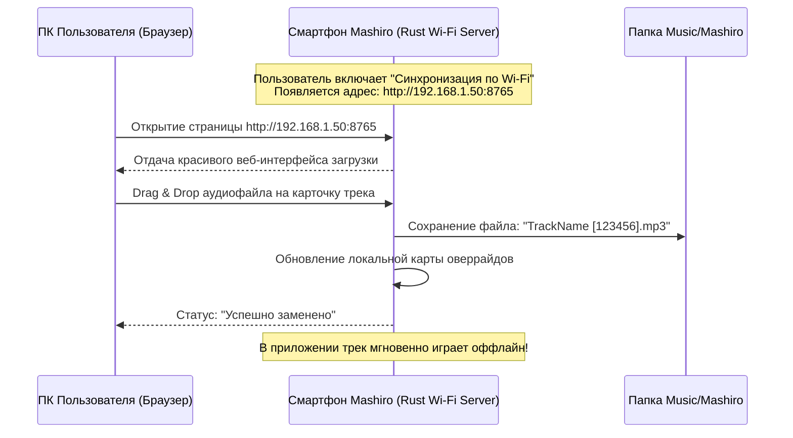

# 04. Замена своих треков и синхронизация с ПК

В данном документе описывается реализация одной из ключевых фишек приложения — **подмена треков на собственные аудиофайлы**, а также удобные способы **переноса музыки с компьютера на телефон**.

---

## 1. Концепция и логика работы подмены треков

В десктопной версии Mashiro пользователь может подменить любой трек на свою версию (например, неизданную версию, FLAC с компьютера, кавер, акустическую версию или трек, удаленный из каталога).

### Принцип сопоставления:
1. **Явный оверрайд (`mashiro.censor.custom`)**: В `censorOverrides.ts` хранится карта `track_id -> { source: string, label: string, at: number }`. Источником может быть либо локальный путь к файлу, либо произвольный URL аудиопотока.
2. **Автоматическое сопоставление по имени файла**: В папке с музыкой треки именуются по маске:
   ```text
   Исполнитель - Название [track_id].flac
   Исполнитель - Название [track_id].mp3
   ```
   Функция `find_local_track` ищет файл, имя которого заканчивается на идентификатор `[id]`. Если файл найден, плеер автоматически воспроизводит локальный файл вместо сетевого потока Я.Музыки.

---

## 2. Проблема файловой системы Android (Scoped Storage) и ее решение

Начиная с Android 11 (API 30) и выше, действует политика изолированного хранилища (**Scoped Storage**): приложениям запрещен произвольный доступ ко всем файлам устройства.

### Архитектура доступа к файлам на Android:
1. **Общедоступная папка `Music/Mashiro`**:
   - Путь: `/storage/emulated/0/Music/Mashiro/`.
   - Доступ на чтение и запись аудиофайлов осуществляется через разрешение `READ_MEDIA_AUDIO` (на Android 13+) или `READ_EXTERNAL_STORAGE` (на Android 12 и ниже).
   - Эта папка видна при подключении телефона к ПК через USB-кабель (по протоколу MTP), а также в любых сторонних проводниках на телефоне.
2. **Внутреннее защищенное хранилище приложения**:
   - `context.getExternalFilesDir(Environment.DIRECTORY_MUSIC)`.
   - Не требует специальных разрешений, доступно для записи напрямую через Rust `std::fs`.
3. **Storage Access Framework (SAF)**:
   - Использование системного пикера `ACTION_OPEN_DOCUMENT` с сохранением постоянных прав доступа `takePersistableUriPermission`.

---

## 3. Инновационный способ копирования с ПК: Встроенный Wi-Fi Sync Server

Подключение смартфона через USB-кабель часто неудобно (нужен провод, переключение режима передачи файлов, медленный протокол MTP). 

Для максимального комфорта в Rust-ядро интегрируется легковесный локальный веб-сервер **`sync_server.rs`** на базе `tokio` и `axum`:



### Возможности веб-интерфейса Wi-Fi Sync:
1. **Отображение текущей библиотеки**: веб-страница на ПК показывает лайкнутые треки и плейлисты прямо из смартфона.
2. **Замена в один клик**: перетаскивание аудиофайла с рабочего стола компьютера прямо на строчку трека на странице. Сервер автоматически переименовывает файл с добавлением `[id]` и сохраняет его на телефон.
3. **Пакетная загрузка папки**: возможность загрузить архив или папку с музыкой; сервер извлекает ID3-теги (название и исполнителя), находит совпадения в вашей медиатеке Яндекс Музыки и автоматически привязывает локальные копии.
4. **Безопасность**: сервер активен только при открытом экране синхронизации в приложении и генерирует одноразовый 4-значный PIN-код или QR-код для авторизации подключения с ПК.

---

## 4. Замена трека прямо с телефона (In-App Picker)

Если аудиофайл уже находится на телефоне (например, скачан из Telegram, браузера или облака):

1. В приложении в меню трека (Track Bottom Sheet) нажимается пункт **«Заменить своей версией»**.
2. Открывается диалоговое окно с двумя вариантами:
   - **«Выбрать локальный файл»**: открывает системный файловый менеджер Android через `ACTION_OPEN_DOCUMENT`. При выборе файла приложение копирует его в папку `Music/Mashiro/Название [id].ext` и регистрирует в `censorOverrides`.
   - **«Указать прямую ссылку»**: ввод URL-адреса аудиопотока (http/https).
3. Поле ввода метки версии: например, *"Lossless FLAC"*, *"Remaster 2024"*, *"Live version"*.
4. После сохранения трек получает отличительный фиолетовый значок **«Своя версия»**, а при его воспроизведении аудиодвижок читает файл с диска.

---

## 5. Экспорт и импорт базы оверрайдов

Для пользователей, у которых уже настроены десятки замен в настольной версии Mashiro:

1. **Экспорт на ПК**: В настройках Mashiro Desktop кнопка *«Экспорт подмен треков»* создает файл `mashiro-overrides.json` следующей структуры:
   ```json
   {
     "version": 1,
     "exported_at": 1729700000000,
     "overrides": {
       "123456": {
         "filename": "Queen - Bohemian Rhapsody [123456].flac",
         "label": "Original Master Tape",
         "at": 1729600000000
       }
     }
   }
   ```
2. **Импорт на смартфоне**:
   - Через Wi-Fi Sync сервер: загрузка `mashiro-overrides.json` вместе с папкой файлов.
   - Через меню настроек телефона: *«Импортировать замены из файла»*.
   - Приложение проверяет наличие указанных файлов в `Music/Mashiro/` и автоматически активирует все подмены.
