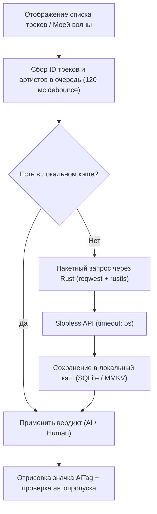

# 05. Модуль «Анти ИИ-слоп» (Интеграция с Slopless)

В данном документе описывается архитектура и реализация системы фильтрации и маркировки сгенерированной искусственным интеллектом музыки (**Anti-AI Slop**) на базе сервиса **Slopless**.

---

## 1. Назначение и актуальность функции

Каталоги стриминговых сервисов, включая «Яндекс Музыку», стремительно наполняются низкокачественными генеративными композициями (Suno, Udio и др.), замаскированными под реальных исполнителей. Модуль «Анти ИИ-слоп» предназначен для:
1. Защиты пользователя от прослушивания сгенерированного спама.
2. Визуальной индикации синтетических треков и исполнителей.
3. Автоматического пропуска ИИ-композиций в рекомендательном потоке «Моя волна».

---

## 2. API и пороговые значения (Slopless API)

Модуль взаимодействует с базой данных `https://slopless.art`:

### 2.1. Проверка исполнителя (`/api/artist/{id}`)
- **Запрос**: `GET https://slopless.art/api/artist/{artist_id}`
- **Ответ**:
  ```json
  {
    "id": "12345678",
    "aiTracks": 14,
    "totalTracks": 20
  }
  ```
- **Логика детекции**: Исполнитель помечается как `AI`, если доля сгенерированных треков превышает порог:
  $$\frac{\text{aiTracks}}{\text{totalTracks}} \ge 0.05 \quad (5\%)$$

### 2.2. Проверка конкретного трека (`/api/track/{id}`)
- **Запрос**: `GET https://slopless.art/api/track/{track_id}`
- **Ответ**:
  ```json
  {
    "id": "98765432",
    "score": 0.87
  }
  ```
- **Логика детекции**: Трек признается сгенерированным, если его балл уверенности превышает порог:
  $$\text{score} > 0.5$$

---

## 3. Архитектура кэширования и оптимизация сетевых запросов

На мобильном устройстве критически важно экономить батарею и трафик. Запросы не должны отправляться повторно на каждый скролл списка.



### Схема хранения кэша:
- **Кэш треков**: Результат неизменен во времени (трек либо сгенерирован, либо нет). Записывается навсегда в локальную SQLite-базу или реактивное хранилище.
- **Кэш артистов**: Время жизни записи (TTL) — 7 дней (так как у артиста могут выходить новые релизы).
- **Graceful Degradation**: При отсутствии интернета или временной недоступности `slopless.art` плеер не зависает, таймаут запроса установлен в 4 секунды, а трек считается обычным.

---

## 4. Пользовательские функции на Android

### 4.1. Автопропуск в «Моей волне» (Auto-skip Slop)
В отличие от десктопной версии, где ИИ-треки только подсвечивались, в мобильной версии добавляется важнейшая опция:
- **«Автоматически пропускать ИИ-музыку»** (включается в настройках).
- При получении следующего трека в потоке рекомендаций клиент проверяет его статус.
- Если трек опознан как ИИ-слоп, приложение отправляет событие `waveFeedback(skip)` в Яндекс Музыку и мгновенно переключается на следующий трек, не воспроизводя спам.

### 4.2. Визуальный индикатор `AiTag.vue`
- В строке трека (`TrackRow.vue`), мини-плеере (`MiniPlayer.vue`) и полноэкранном плеере отображается неоновый значок **`AI`** с предупреждающей подсветкой.
- При нажатии на значок открывается поясняющая карточка с детальной статистикой из Slopless (например: *"87% вероятность ИИ-генерации"* или *"У данного артиста 14 из 20 треков сгенерированы"*).

### 4.3. Фильтр в плейлистах и поиске
- Переключатель в шапке поисковой выдачи: **«Скрыть ИИ-слоп»** — скрывает из выдачи треки с подтвержденной генерацией.
- Защита любимых плейлистов: предупреждение при добавлении подозрительного трека в коллекцию.
