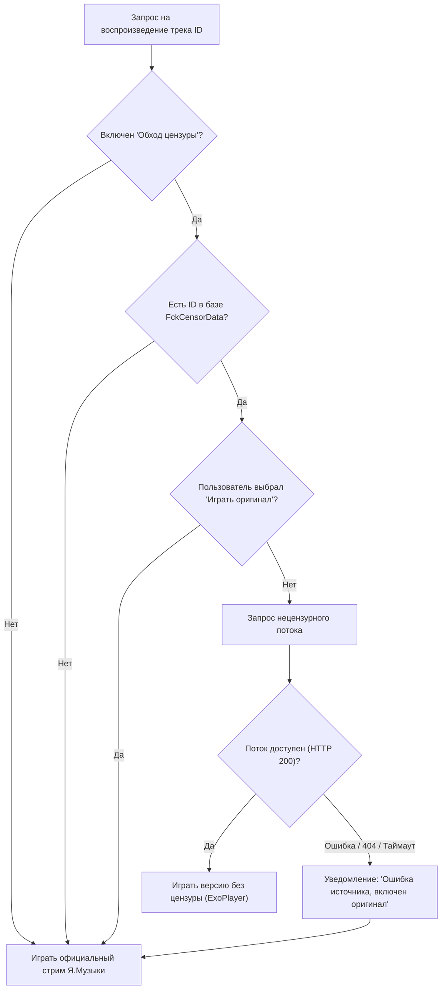

# 06. Автозамена цензурных треков (FckCensorData)

В данном документе описывается модуль автоматического обхода цензуры и подмены записей на оригинальные нецензурные версии (Explicit) с использованием репозитория **Hazzz895/FckCensorData**.

---

## 1. Проблема цензуры в «Яндекс Музыке»

Многие популярные треки в официальном каталоге «Яндекс Музыки» подвергаются цензуре (заглушение ненормативной лексики, вырезание куплетов или использование «Radio Edit» версий).

Проект решает эту проблему интеграцией с открытой базой данных **FckCensorData**, которая содержит сопоставление цензурированных треков каталога с их оригинальными версиями без купюр.

---

## 2. Источник данных и протокол обновления

- **Репозиторий источника**: `https://github.com/Hazzz895/FckCensorData`
- **Прямой URL списка**: `https://raw.githubusercontent.com/Hazzz895/FckCensorData/main/list.json`
- **Структура `list.json`**:
  ```json
  {
    "tracks": {
      "1234567": "https://raw.githubusercontent.com/.../audio.mp3",
      "9876543": "https://cdn.example.com/.../explicit.flac"
    }
  }
  ```

### Логика кэширования:
1. **TTL списка**: 24 часа. При запуске приложения и наличии Wi-Fi клиент проверяет ETag/хеш файла `list.json`.
2. **Локальное хранение**: База сопоставлений сохраняется в локальное хранилище (`mashiro.censor.map` или SQLite), благодаря чему подмена работает мгновенно даже в оффлайн-режиме для уже закэшированных треков.

---

## 3. Архитектура резолвинга и отказоустойчивый Fallback



### Преимущество перед десктопной версией:
В десктопной версии при недоступности внешней ссылки воспроизведение могло остановиться с ошибкой `audio error`. В мобильной версии реализован **бесшовный Fallback**: если удаленный CDN с треком без цензуры не отвечает в течение 2.5 секунд, плеер мгновенно переключается на стандартный поток Я.Музыки.

---

## 4. Пользовательский интерфейс и управление версиями

1. **Индикация в плеере**:
   - Если играет версия без цензуры, рядом с названием трека отображается яркий бейдж **`EXPLICIT`** (или перечеркнутый значок цензуры).
   - В строке трека отображается иконка доступности нецензурной версии.
2. **Мгновенное переключение на лету**:
   - В меню трека (Bottom Sheet) и на экране полноэкранного плеера находится переключатель:
     - 🔘 **«Версия без цензуры»** (FckCensorData / своя замена)
     - ⚪ **«Официальная версия Я.Музыки»**
   - Выбор сохраняется индивидуально для каждого трека в настройках предпочтений (`prefersOriginal`), позволяя пользователю для определенных песен оставлять радио-версию, если она ему больше нравится.
3. **Объединение с пользовательскими подменами**:
   - Приоритет источников выстроен прозрачно:
     1. Локальный собственный файл пользователя с ПК (`censorOverrides` / `find_local_track`).
     2. Версия без цензуры из базы `FckCensorData`.
     3. Официальный стрим «Яндекс Музыки».
