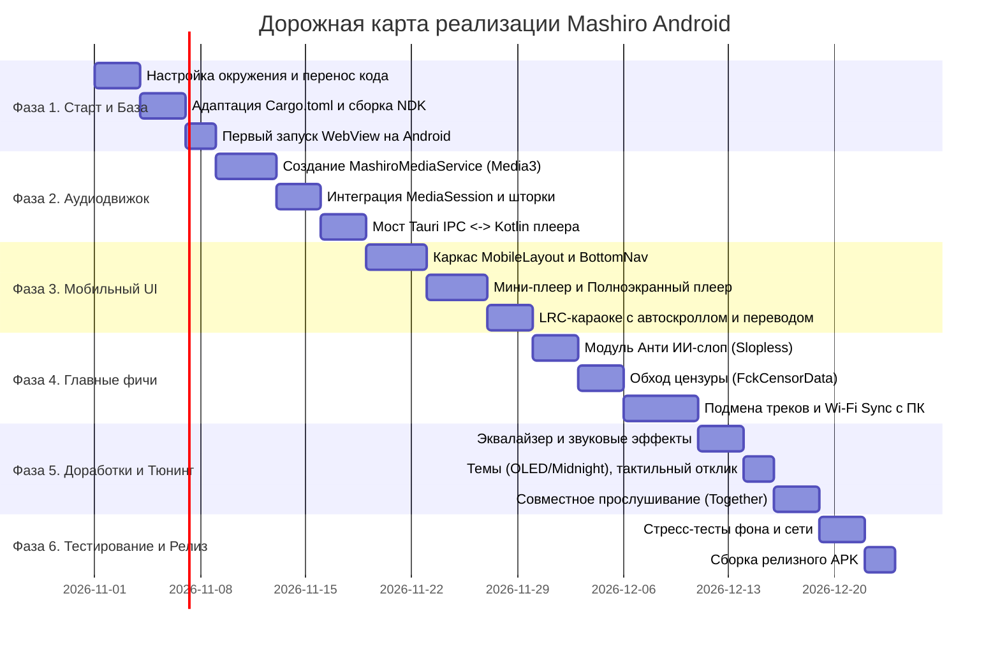

# 09. Поэтапный план реализации (Roadmap)

В данном документе представлен детальный пошаговый план разработки **Mashiro Android**, разбитый на 6 последовательных фаз с критериями готовности и оценкой рисков.

---

## 1. Календарный план и этапы разработки

---

## 2. Детализация фаз разработки

### Фаза 1: Развертывание и сборка базового ядра
- [ ] Перенос исходников из ветки `v2` репозитория в рабочую папку проекта.
- [ ] Аудит зависимостей `Cargo.toml`: отключение несовместимых десктопных библиотек (`tray-icon`, `global-shortcut`, `keyring`).
- [ ] Адаптация платформозависимых вызовов (`open_in_browser`, пути файлов).
- [ ] Выполнение `tauri android init` и компиляция динамической библиотеки `.so` под архитектуры `arm64-v8a` и `x86_64`.
- [ ] **Критерий готовности**: Приложение успешно собирается, устанавливается на устройство и отображает экран входа (OAuth / токен).

### Фаза 2: Нативный фоновый аудиоплеер (Media3)
- [ ] Подключение Jetpack Media3 (`media3-exoplayer`, `media3-session`) в `build.gradle.kts`.
- [ ] Создание `MashiroMediaService.kt` (`ForegroundService` типа `mediaPlayback`).
- [ ] Реализация системного уведомления в шторке с обложкой, полосой перемотки и кнопками управления.
- [ ] Обработка событий `AudioFocus` (пауза при звонке, восстановление при завершении).
- [ ] Создание Kotlin-плагина `MediaBridgePlugin` и связывание команд `play/pause/seek` с фронтендом.
- [ ] **Критерий готовности**: Музыка воспроизводится непрерывно при выключенном экране и при сворачивании приложения.

### Фаза 3: Мобильный интерфейс и навигация
- [ ] Замена десктопного каркаса `MainLayout.vue` на `MobileLayout.vue` с поддержкой `safe-area-inset`.
- [ ] Реализация нижней панели навигации `MobileBottomNav.vue` (Главная, Волна, Поиск, Коллекция, Настройки).
- [ ] Разработка плавающего мини-плеера `MobileMiniPlayer.vue` со свайпами переключения треков.
- [ ] Разработка полноэкранного плеера `MobileFullscreenPlayer.vue` с динамическим фоном от обложки.
- [ ] Адаптация экрана текстов песен LRC: плавный автоскролл активной строки, романизация и перевод строк.
- [ ] Создание нижних шторок действий `TrackBottomSheet.vue` вместо контекстных меню мыши.
- [ ] **Критерий готовности**: Удобная навигация одной рукой, корректная работа жеста «Назад» на всех экранах.

### Фаза 4: Реализация ключевых уникальных фишек
- [ ] **4.1. Анти ИИ-слоп (Slopless)**:
  - Интеграция с API `https://slopless.art` в Rust-ядре.
  - Локальное кэширование проверенных ID (SQLite/KV).
  - Отображение бейджа `AiTag` в строке трека и плеере.
  - Опция автопропуска ИИ-музыки в «Моей волне».
- [ ] **4.2. Автозамена цензурных треков (FckCensorData)**:
  - Автозагрузка и обновление `list.json` с репозитория `Hazzz895/FckCensorData`.
  - Бесшовный резолвинг и Fallback на официальную версию при недоступности внешнего CDN.
  - Переключатель версии («Без цензуры» / «Оригинал») в меню трека и плеере.
- [ ] **4.3. Подмена своих треков и синхронизация с ПК**:
  - Настройка директории `/storage/emulated/0/Music/Mashiro/` и сопоставление по маске `[id]`.
  - Системный файловый пикер SAF для ручной привязки аудиофайлов с телефона.
  - Реализация встроенного **Wi-Fi Sync Server** на Rust (порт `8765`): веб-страница на ПК для перетаскивания файлов прямо в телефон.
  - Экспорт и импорт базы замен `mashiro-overrides.json`.
- [ ] **Критерий готовности**: Все три фишки работают стабильно, треки заменяются, ИИ отфильтровывается, цензура обходится.

### Фаза 5: Дополнительный функционал и полировка
- [ ] 10-полосный нативный эквалайзер Android (`android.media.audiofx.Equalizer`) с пресетами.
- [ ] Адаптация 11 тем оформления (включая OLED Black) и 8 акцентных цветов.
- [ ] Тактильный отклик (Haptics) на ключевые действия.
- [ ] Совместное прослушивание **Together** (P2P/релеи через WebSocket и dalek-криптографию).
- [ ] **Критерий готовности**: Плавные 60/120 FPS анимации, мгновенный отклик интерфейса.

### Фаза 6: Тестирование и релиз
- [ ] Тестирование непрерывного воспроизведения в фоне (тест на 2 часа непрерывной музыки).
- [ ] Тестирование на разных версиях Android: Android 11, Android 12, Android 13, Android 14, Android 15.
- [ ] Тестирование перехода Wi-Fi <-> Мобильная сеть (автовозобновление кэша).
- [ ] Сборка финального релизного APK с оптимизацией ProGuard/R8.
- [ ] **Критерий готовности**: Стабильный подписанный `app-release.apk`, готовый к установке.

---

## 3. Матрица рисков и их нейтрализация

| Риск | Вероятность | Влияние | Стратегия предотвращения |
|---|---|---|---|
| Система глушит сервис при экономии батареи (MIUI, OneUI) | Высокая | Высокая | Использование `FOREGROUND_SERVICE_MEDIA_PLAYBACK` + подсказка пользователю об отключении оптимизации батареи в настройках приложения. |
| Ссылка из FckCensorData недоступна или заблокирована | Средняя | Средняя | Реализация таймаута в 2.5 с и бесшовный Fallback на официальный поток Я.Музыки с уведомлением. |
| Большой объем памяти при загрузке тяжелых списков | Низкая | Средняя | Использование виртуализации списков (`q-virtual-scroll` или Intersection Observer) как в оригинальном `LazyTracks.vue`. |
| Проблемы с Scoped Storage на Android 13/14+ | Средняя | Средняя | Использование стандартного публичного хранилища `Environment.DIRECTORY_MUSIC` и встроенного Wi-Fi Sync веб-сервера. |
